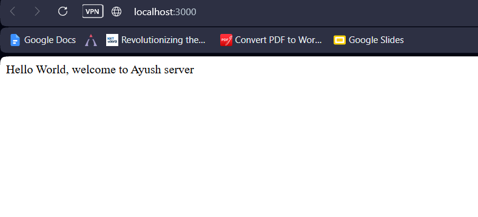
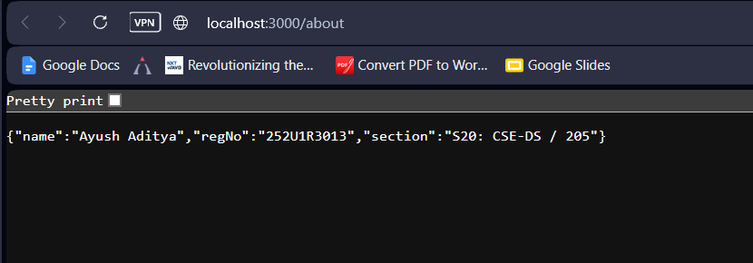
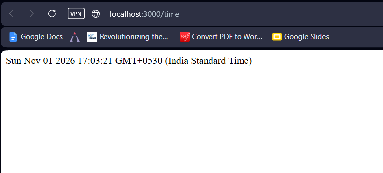
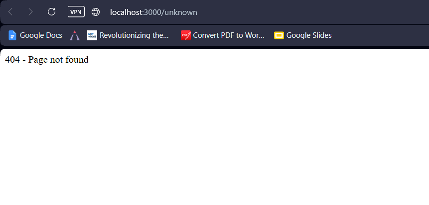
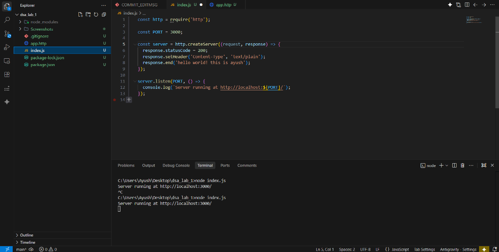
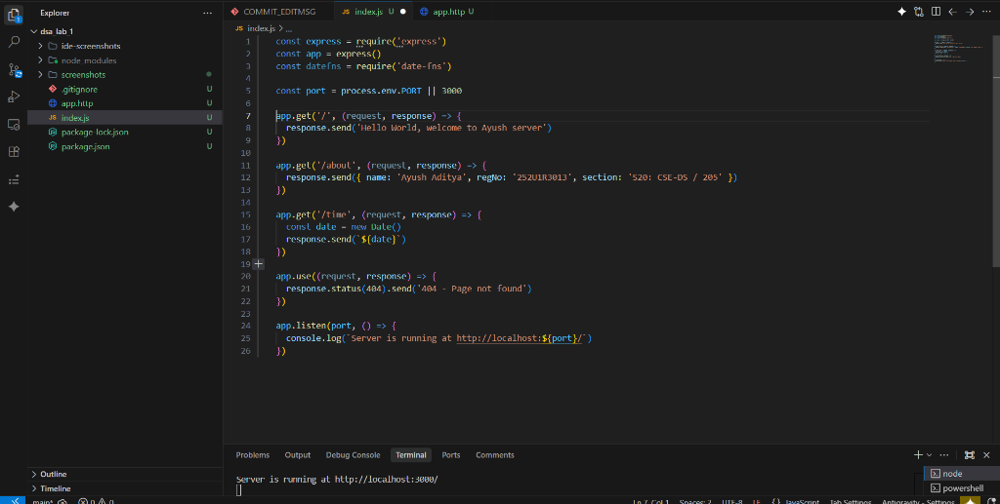
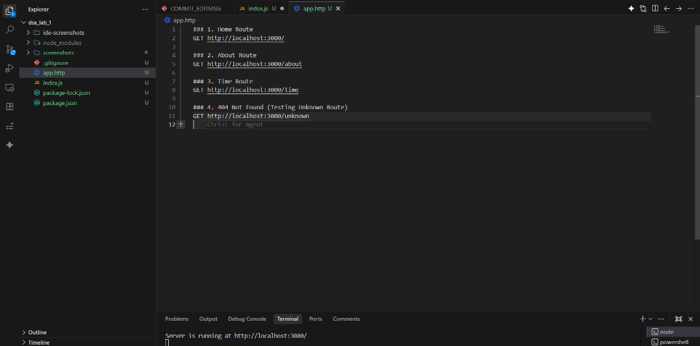

# Backend Development Fundamentals – Lab Report 1

## Student Information

| Field | Details |
| :--- | :--- |
| **Student Name** | Ayush Aditya |
| **Registration Number** | 252U1R3013 |
| **Class & Section** | CSE-DS 1A / 205 |
| **Study Level** | Undergraduate (B.Tech) |
| **Year & Term** | 2nd Year – Term 2 |
| **Subject** | Backend Development Fundamentals |
| **Assessment** | Lab Report 1 |
| **University** | Aurora Deemed to be University |

---

## 1. Objective

The objective of this lab is to build fundamental backend development skills using Node.js and Express.js by:
- Initializing and structuring a Node.js project using npm.
- Understanding the difference between a core Node.js HTTP server and an Express.js server.
- Creating an Express.js application handling multiple HTTP GET routes.
- Returning formatted plain text, JSON objects with personal student credentials, and dynamic timestamps using JavaScript's native `Date` object.
- Handling unknown / invalid endpoints with custom `404 - Page not found` status responses.
- Testing API endpoints locally using `app.http` (REST Client) and web browsers.
- Deploying the live backend service to the cloud using Render.

---

## 2. Technologies Used

- **Runtime Environment:** Node.js (v26.13.0)
- **Web Framework:** Express.js (^5.3.0)
- **Utility Library:** date-fns (^4.1.0)
- **Package Manager:** npm
- **Testing & Tooling:** REST Client (`app.http`), Web Browser
- **Version Control:** Git & GitHub
- **Deployment Platform:** Render

---

## 3. Project Structure

```text
Backend-Development-Fundamentals-Lab-1/
├── ide-screenshots/
│   ├── 01-node-http-server.png
│   ├── 02-express-server.png
│   └── 03-app-http.png
├── screenshots/
│   ├── home.png
│   ├── about.png
│   ├── time.png
│   └── 404.png
├── .gitignore
├── app.http
├── index.js
├── package-lock.json
├── package.json
└── README.md
```

---

## 4. Route Specifications & Endpoints

| Method | Endpoint | Description | Expected Response |
| :--- | :--- | :--- | :--- |
| `GET` | `/` | Home route displaying a welcome message | `"Hello World, welcome to Ayush server"` |
| `GET` | `/about` | Returns student details in structured JSON format | `{"name":"Ayush Aditya","regNo":"252U1R3013","section":"CSE-DS 1A / 205"}` |
| `GET` | `/time` | Returns the current server timestamp using `new Date()` | Server date & time string |
| `ALL` | `*` (Any unknown) | Catches all undefined routes | `404 - Page not found` |

---

## 5. Implementation Details

### Server Implementation (`index.js`)

```javascript
const express = require('express')
const app = express()
const datefns = require('date-fns')

const port = process.env.PORT || 3000

// 1. Home Route: GET /
app.get('/', (request, response) => {
  response.send('Hello World, welcome to Ayush server')
})

// 2. About Route: GET /about
app.get('/about', (request, response) => {
  response.send({ name: 'Ayush Aditya', regNo: '252U1R3013', section: 'CSE-DS 1A / 205' })
})

// 3. Time Route: GET /time
app.get('/time', (request, response) => {
  const date = new Date()
  response.send(`${date}`)
})

// 4. Unknown Route: 404 Handler
app.use((request, response) => {
  response.status(404).send('404 - Page not found')
})

app.listen(port, () => {
  console.log(`Server is running at http://localhost:${port}/`)
})
```

---

## 6. Execution & Testing Instructions

### Local Setup

1. **Clone the repository:**
   ```bash
   git clone https://github.com/zeph7907/Backend-Development-Fundamentals-Lab-1.git
   cd Backend-Development-Fundamentals-Lab-1
   ```

2. **Install project dependencies:**
   ```bash
   npm install
   ```

3. **Start the server:**
   ```bash
   npm start
   ```
   *(or `node index.js`)*

4. **Verify the server:**
   The terminal will log:
   ```text
   Server is running at http://localhost:3000/
   ```

---

## 7. Output Screenshots

### 1. Home Route (`GET /`)
URL: `http://localhost:3000/`



---

### 2. About Route (`GET /about`)
URL: `http://localhost:3000/about`



---

### 3. Time Route (`GET /time`)
URL: `http://localhost:3000/time`



---

### 4. 404 Error Handling (`GET /unknown`)
URL: `http://localhost:3000/unknown`



---

## 8. Development & IDE Screenshots

### Basic Node.js HTTP Server


### Express Application Server Implementation


### REST Client Testing (`app.http`)


---

## 9. Cloud Deployment (Render)

- **Platform:** Render (Web Service)
- **Environment:** Node.js
- **Build Command:** `npm install`
- **Start Command:** `npm start`
- **Live Deployment URL:** [https://backend-development-fundamentals-lab-1-nk19.onrender.com](https://backend-development-fundamentals-lab-1-nk19.onrender.com)

### Live Endpoint Links:
- **Home Route:** [https://backend-development-fundamentals-lab-1-nk19.onrender.com/](https://backend-development-fundamentals-lab-1-nk19.onrender.com/)
- **About Route:** [https://backend-development-fundamentals-lab-1-nk19.onrender.com/about](https://backend-development-fundamentals-lab-1-nk19.onrender.com/about)
- **Time Route:** [https://backend-development-fundamentals-lab-1-nk19.onrender.com/time](https://backend-development-fundamentals-lab-1-nk19.onrender.com/time)
- **404 Route Test:** [https://backend-development-fundamentals-lab-1-nk19.onrender.com/unknown](https://backend-development-fundamentals-lab-1-nk19.onrender.com/unknown)

---

## 10. Learning Outcomes

1. **Node.js Core Architecture:** Gained hands-on understanding of creating raw HTTP servers using Node's standard library versus high-level web frameworks.
2. **Express.js Routing:** Learned how to define routing logic, parse requests, and deliver text and JSON payloads with appropriate HTTP status codes.
3. **Environment Adaptability:** Implemented dynamic port configuration (`process.env.PORT || 3000`) for seamless transition between local development and cloud production.
4. **API Testing:** Mastered rapid endpoint verification using VS Code REST Client (`app.http`) alongside browser-based testing.
5. **Full Lifecycle Deployment:** Successfully version-controlled the application with Git/GitHub and deployed a live cloud instance on Render.

---

## 11. Conclusion

This lab successfully implemented a functional, production-ready backend service fulfilling all academic criteria. The application demonstrates modular routing, proper error handling, structured JSON delivery, and cloud deployment readiness.
