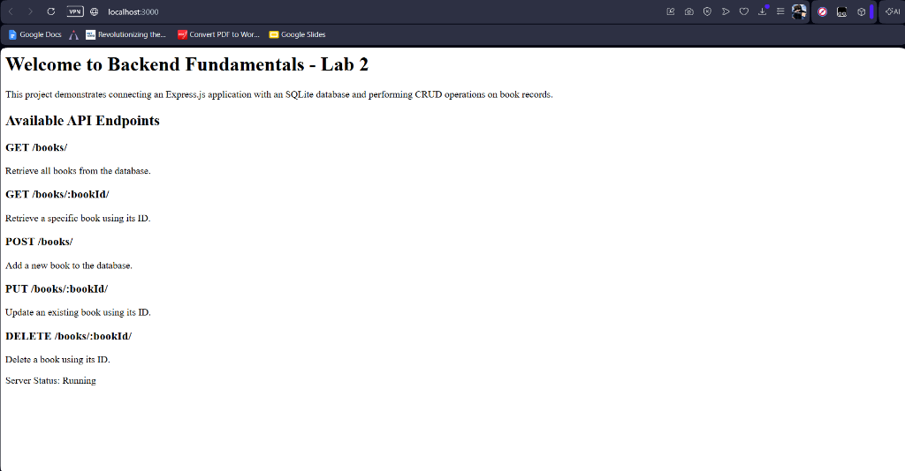
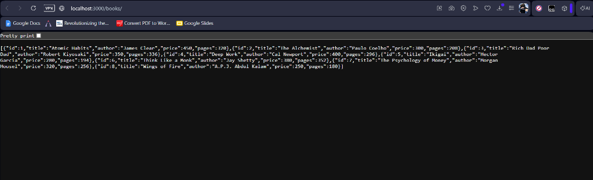
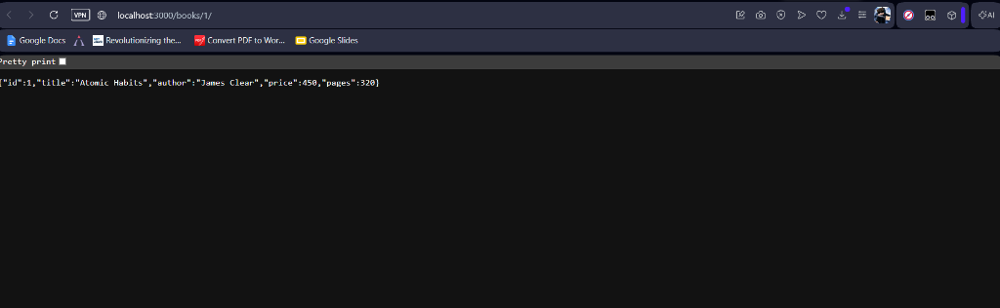
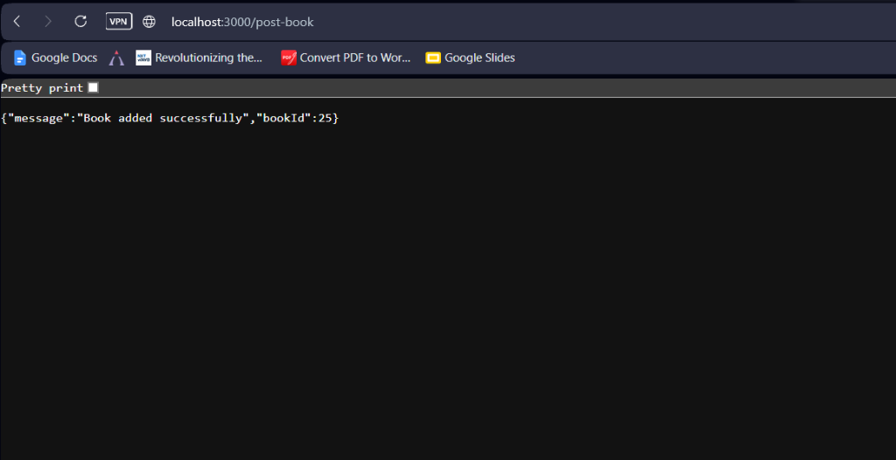
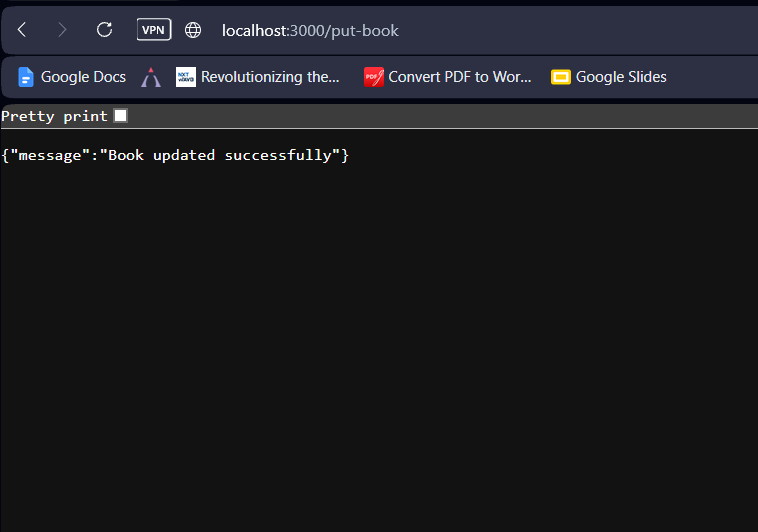
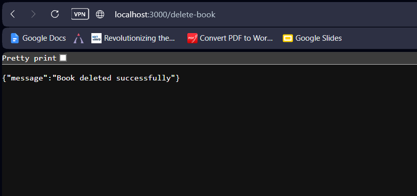

# Backend Development Fundamentals – Lab Report 2

## Subject Information

| Field | Details |
| :--- | :--- |
| **Subject** | Backend Development Fundamentals |
| **Assessment** | Lab Report 2 |
| **Year & Term** | 2nd Year – Term 2 |
| **University** | Aurora Deemed to be University |
| **Faculty** | Mr. Joel Prashanth D |

## Student Information

| Field | Details |
| :--- | :--- |
| **Student Name** | Ayush Aditya |
| **Registration Number** | 252U1R3013 |
| **Class & Section** | CSE-DS 1A / 205 (S20: CSE-DS / 205) |
| **Study Level** | Undergraduate (B.Tech) |
| **Year & Term** | 2nd Year – Term 2 |
| **Subject** | Backend Development Fundamentals |
| **Assessment** | Lab Report 2 |
| **University** | Aurora Deemed to be University |

---

## 1. Objective

The objective of this laboratory assignment is to integrate an SQLite relational database with an Express.js backend application and implement full CRUD (Create, Read, Update, Delete) capabilities:
- Setting up and establishing asynchronous database connectivity using `sqlite` and `sqlite3` driver libraries.
- Defining a structured relational table schema (`book`) with primary key and auto-increment properties.
- Developing RESTful HTTP endpoints conforming to standard HTTP verbs (`GET`, `POST`, `PUT`, `DELETE`).
- Utilizing parameterized SQL queries (`?` placeholders) to prevent SQL injection vulnerabilities and handle data safely.
- Parsing incoming request parameters (`request.params`) and JSON request payloads (`request.body`).
- Implementing robust error handling and returning appropriate HTTP status codes (`200 OK`, `201 Created`, `404 Not Found`, `500 Internal Server Error`).
- Creating an `app.http` testing suite for 1-click endpoint verification in VS Code using REST Client / Thunder Client.
- Deploying the live backend service to the cloud on Render.

---

## 2. Technologies Used

- **Runtime Environment:** Node.js (v26.13.0)
- **Web Framework:** Express.js (^5.3.0)
- **Database Engine:** SQLite3 (^5.1.7)
- **Database Wrapper:** sqlite (^5.1.1)
- **Development Tool:** nodemon (^3.1.9)
- **Testing & Tooling:** REST Client (`app.http`), Thunder Client, Web Browser
- **Version Control:** Git & GitHub
- **Cloud Deployment:** Render (Web Service)

---

## 3. Project Structure

```text
Backend-Development-Fundamentals-Lab-2/
├── Screenshots/
│   ├── home.png
│   ├── get-all-books.png
│   ├── get-book-by-id.png
│   ├── post-book.png
│   ├── put-book.png
│   └── delete-book.png
├── .gitignore
├── app.http
├── app.js
├── books.db
├── database.js
├── package-lock.json
├── package.json
└── README.md
```

---

## 4. Database Architecture & Schema

### Database File: `books.db`
### Table Name: `book`

| Column | Data Type | Constraints | Description |
| :--- | :--- | :--- | :--- |
| `id` | `INTEGER` | `PRIMARY KEY AUTOINCREMENT` | Unique auto-generated book identifier |
| `title` | `TEXT` | `NOT NULL` | Title of the book |
| `author` | `TEXT` | `NOT NULL` | Author of the book |
| `price` | `INTEGER` | `NOT NULL` | Price in Indian Rupees (₹) |
| `pages` | `INTEGER` | `NOT NULL` | Total number of pages |

### Table Creation DDL Query:
```sql
CREATE TABLE IF NOT EXISTS book (
  id INTEGER PRIMARY KEY AUTOINCREMENT,
  title TEXT,
  author TEXT,
  price INTEGER,
  pages INTEGER
);
```

### Initial Seed Data:
The application automatically seeds 8 standard book records upon initial startup:
1. *Atomic Habits*, James Clear, ₹450, 320 pages
2. *The Alchemist*, Paulo Coelho, ₹300, 208 pages
3. *Rich Dad Poor Dad*, Robert Kiyosaki, ₹350, 336 pages
4. *Deep Work*, Cal Newport, ₹400, 296 pages
5. *Ikigai*, Hector Garcia, ₹280, 194 pages
6. *Think Like a Monk*, Jay Shetty, ₹380, 352 pages
7. *The Psychology of Money*, Morgan Housel, ₹320, 256 pages
8. *Wings of Fire*, A.P.J. Abdul Kalam, ₹250, 180 pages

---

## 5. API Endpoints Specification

| Method | Endpoint | Description | Request Body | Expected Status |
| :--- | :--- | :--- | :--- | :--- |
| `GET` | `/` | Home / Documentation page with student details and API summary | None | `200 OK` |
| `GET` | `/books/` | Retrieve all book records from database | None | `200 OK` |
| `GET` | `/books/:bookId/` | Retrieve a specific book by ID | None | `200 OK` / `404 Not Found` |
| `POST` | `/books/` | Insert a new book record into the database | JSON `{ title, author, price, pages }` | `201 Created` |
| `PUT` | `/books/:bookId/` | Update an existing book's details by ID | JSON `{ title, author, price, pages }` | `200 OK` / `404 Not Found` |
| `DELETE` | `/books/:bookId/` | Delete an existing book by ID | None | `200 OK` / `404 Not Found` |

---

## 6. Implementation Code

### Database Connection Module (`database.js`)
```javascript
const sqlite3 = require('sqlite3');
const { open } = require('sqlite');
const path = require('path');

const dbPath = path.join(__dirname, 'books.db');

const openDatabase = async () => {
  const database = await open({
    filename: dbPath,
    driver: sqlite3.Database,
  });

  console.log('Database connected successfully');
  return database;
};

module.exports = openDatabase;
```

### Server & CRUD Operations (`app.js`)
```javascript
const express = require('express');
const openDatabase = require('./database');

const app = express();
app.use(express.json());

let db;

const initializeDBAndServer = async () => {
  try {
    db = await openDatabase();

    await db.run(`
      CREATE TABLE IF NOT EXISTS book (
        id INTEGER PRIMARY KEY AUTOINCREMENT,
        title TEXT,
        author TEXT,
        price INTEGER,
        pages INTEGER
      );
    `);

    const PORT = process.env.PORT || 3000;
    app.listen(PORT, () => {
      console.log(`Server running at http://localhost:${PORT}/`);
    });
  } catch (error) {
    console.error(`Database initialization error: ${error.message}`);
    process.exit(1);
  }
};

// 1. Home / Documentation Route
app.get('/', (request, response) => {
  // Returns HTML documentation with Ayush Aditya (252U1R3013) details
});

// 2. GET /books/ - Retrieve all books
app.get('/books/', async (request, response) => {
  try {
    const getBooksQuery = `SELECT * FROM book;`;
    const books = await db.all(getBooksQuery);
    response.status(200).send(books);
  } catch (error) {
    response.status(500).send({ error: error.message });
  }
});

// 3. GET /books/:bookId/ - Retrieve specific book by ID
app.get('/books/:bookId/', async (request, response) => {
  try {
    const { bookId } = request.params;
    const getBookQuery = `SELECT * FROM book WHERE id = ?;`;
    const book = await db.get(getBookQuery, bookId);

    if (book === undefined) {
      response.status(404).send({ message: 'Book not found' });
    } else {
      response.status(200).send(book);
    }
  } catch (error) {
    response.status(500).send({ error: error.message });
  }
});

// 4. POST /books/ - Insert new book
app.post('/books/', async (request, response) => {
  try {
    const { title, author, price, pages } = request.body;
    const addBookQuery = `
      INSERT INTO book (title, author, price, pages)
      VALUES (?, ?, ?, ?);
    `;

    const result = await db.run(addBookQuery, title, author, price, pages);
    response.status(201).send({
      message: 'Book added successfully',
      bookId: result.lastID,
    });
  } catch (error) {
    response.status(500).send({ error: error.message });
  }
});

// 5. PUT /books/:bookId/ - Update existing book
app.put('/books/:bookId/', async (request, response) => {
  try {
    const { bookId } = request.params;
    const { title, author, price, pages } = request.body;

    const updateBookQuery = `
      UPDATE book
      SET title = ?, author = ?, price = ?, pages = ?
      WHERE id = ?;
    `;

    const result = await db.run(
      updateBookQuery,
      title,
      author,
      price,
      pages,
      bookId
    );

    if (result.changes === 0) {
      response.status(404).send({ message: 'Book not found' });
    } else {
      response.status(200).send({ message: 'Book updated successfully' });
    }
  } catch (error) {
    response.status(500).send({ error: error.message });
  }
});

// 6. DELETE /books/:bookId/ - Delete book by ID
app.delete('/books/:bookId/', async (request, response) => {
  try {
    const { bookId } = request.params;
    const deleteBookQuery = `DELETE FROM book WHERE id = ?;`;

    const result = await db.run(deleteBookQuery, bookId);

    if (result.changes === 0) {
      response.status(404).send({ message: 'Book not found' });
    } else {
      response.status(200).send({ message: 'Book deleted successfully' });
    }
  } catch (error) {
    response.status(500).send({ error: error.message });
  }
});

initializeDBAndServer();
module.exports = app;
```

---

## 7. Execution & Testing Instructions

### Local Setup
1. **Clone the repository:**
   ```bash
   git clone https://github.com/zeph7907/Backend-Development-Fundamentals-Lab-2.git
   cd Backend-Development-Fundamentals-Lab-2
   ```

2. **Install project dependencies:**
   ```bash
   npm install
   ```

3. **Start the application:**
   ```bash
   npm start
   ```
   *(or `npm run dev` for auto-reloading with nodemon)*

4. **Verify the server:**
   ```text
   Database connected successfully
   Book table verified/created successfully
   Server running at http://localhost:3000/
   ```

5. **Test Endpoints:**
   Open `app.http` in VS Code and click **"Send Request"** above any endpoint.

---

## 8. Output Screenshots

### 1. Application Home Page (`GET /`)
URL: `http://localhost:3000/`



---

### 2. Retrieve All Books (`GET /books/`)
URL: `http://localhost:3000/books/`



---

### 3. Retrieve Specific Book by ID (`GET /books/1/`)
URL: `http://localhost:3000/books/1/`



---

### 4. Add a New Book (`POST /books/`)
URL: `http://localhost:3000/books/`



---

### 5. Update an Existing Book (`PUT /books/1/`)
URL: `http://localhost:3000/books/1/`



---

### 6. Delete a Book by ID (`DELETE /books/8/`)
URL: `http://localhost:3000/books/8/`



---

## 9. Cloud Deployment (Render)

- **Platform:** Render (Web Service)
- **Environment:** Node.js
- **Build Command:** `npm install`
- **Start Command:** `node app.js`
- **Live Deployment URL:** *[To be updated after Render service creation]*

---

## 10. Key Concepts Learned

1. **Relational Database Connectivity:** Integrated SQLite directly into an Express.js backend using asynchronous methods (`open({ filename, driver })`).
2. **Database Driver Mechanics:** Utilized `sqlite3` as the native driver and `sqlite` as the modern promise-based wrapper to execute async/await queries without callback pyramids.
3. **Parameterized SQL Queries:** Implemented `?` placeholders for query arguments in `INSERT`, `UPDATE`, `SELECT`, and `DELETE` queries to prevent SQL injection vulnerabilities.
4. **Data Manipulation Operations:**
   - `db.all()` for fetching multiple records (e.g., all books).
   - `db.get()` for retrieving a single record matching an ID.
   - `db.run()` for executing data manipulation statements and inspecting `result.lastID` and `result.changes`.
5. **RESTful HTTP Semantics:** Implemented standard HTTP response codes (`200 OK`, `201 Created`, `404 Not Found`, `500 Server Error`).

---

## 11. Git Hygiene

The following entries are included in `.gitignore`:
```gitignore
node_modules/
.env
*.log
.DS_Store
Thumbs.db
```
Secrets, environment variables, credentials, and `node_modules/` are strictly excluded from version control.

---

## 12. Conclusion

This laboratory successfully completed all requirements for Lab 2 of Backend Development Fundamentals. An Express server with a connected SQLite database was created, initialized, and verified across all CRUD endpoints using parameterized SQL queries and thorough status code handling.
